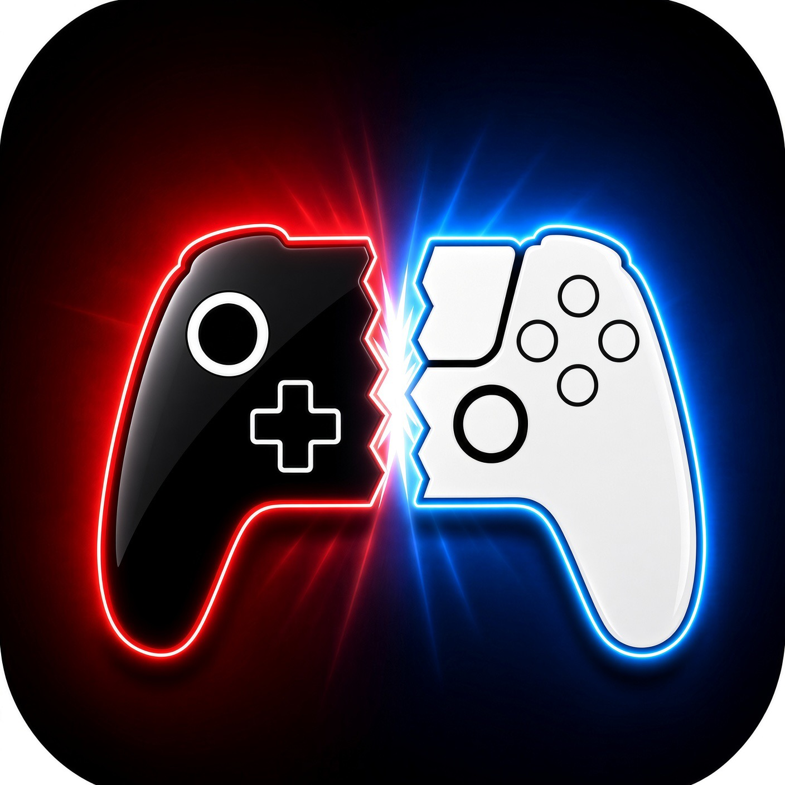

<p align="center">
  
</p>

# PlayTendo

App d'émulation pour **iPhone, iPad et Mac** : une seule bibliothèque pour les consoles Nintendo et Sony,
de la NES à la PS Vita. App personnelle, installée sur iPhone avec AltStore.

> Aucun jeu ni BIOS n'est fourni : utilise les tiens. App non affiliée à Nintendo ni à Sony.

## Télécharger

Les versions prêtes à installer sont dans **[Releases](../../releases)** :

| Fichier | Pour | Installation |
|---|---|---|
| `PlayTendo.ipa` | iPhone, iPad | AltServer sur le Mac (icône › ⌥ › « Sideload .ipa… ») ou AltStore. Toujours installer **par-dessus** l'ancienne version : supprimer l'app effacerait jeux et sauvegardes. |
| `PlayTendo.dmg` | Mac avec puce Apple (M1 ou plus récent), macOS 14 ou plus | Glisser PlayTendo dans Applications. Si macOS la bloque : Réglages Système › Confidentialité et sécurité › « Ouvrir quand même ». |

## Consoles

| Console | Moteur | Version |
|---|---|---|
| NES | Mesen | 0.9.9 |
| Super Nintendo | bsnes | v115 |
| Nintendo 64 | Mupen64Plus-Next | commit 12edd2c |
| Game Boy, Game Boy Color | Gambatte | commit 7809bb6 |
| Game Boy Advance | mGBA | 0.10.5 |
| Nintendo DS | melonDS DS | 1.4.0 |
| Nintendo 3DS | Azahar | 2126.1.2 |
| GameCube, Wii | Dolphin (DolphiniOS) | 5.0.0b6 |
| PlayStation | PCSX-ReARMed | r26l |
| PlayStation 2 | ARMSX2 iOS | 2.6.0 |
| PlayStation Portable | PPSSPP | v1.20.4 |
| PS Vita (**expérimental**) | Vita3K | build 4135 |

**PS Vita : expérimental.** Le moteur Vita3K n'a pas encore de version stable : certains jeux plantent, s'affichent
mal ou ne démarrent pas. Il faut le firmware de ta console (`PSVUPDAT.PUP`, dans le dossier BIOS) et, sur iPhone,
le mode turbo (StikDebug).

La liste des formats acceptés et des BIOS est dans le fichier **Lisez-moi.txt** que l'app crée dans ses
Documents.

## Fonctions

- **Ajouter des jeux** : app Fichiers (iPhone, iPad), glisser-déposer dans la fenêtre (Mac), ou bouton « + » :
  plusieurs fichiers à la fois, un dossier entier (sous-dossiers compris) et les archives .zip/.7z/.rar,
  décompressées toutes seules. BIOS PS2 importé depuis les Réglages.
- **Bibliothèque** : jeux reconnus tout seuls (No-Intro, Redump), jaquettes en boîtes 3D (ScreenScraper, libretro,
  SteamGridDB), fiches des jeux, favoris et tri (nom, dernière partie, ajout récent) ; jeux en plusieurs disques
  regroupés (PS1, GameCube) ; jaquette perso ; patchs de romhacks .ips/.bps/.ups (le jeu d'origine n'est jamais
  modifié) ; homebrews 3DS (dossier `3ds/` posé sur la carte SD de la 3DS). Reste rapide avec des centaines de jeux.
- **Image** : jusqu'à 4 fois la résolution (N64, DS, 3DS, PS2, PSP…), 16:9 (N64, PS2, GameCube), filtres
  net/lissé/CRT/LCD pour les consoles 2D ; DS en x1 = rendu fidèle de melonDS ; plein écran sur Mac.
- **Fluidité** : moins d'à-coups en 3DS, GameCube et Wii (effets graphiques préparés en arrière-plan), GameCube et
  Wii sur deux cœurs du processeur ; en pause, le son et l'image s'arrêtent et l'écran peut s'éteindre (batterie).
- **Menu pause** : sauvegarde rapide, avance rapide et retour en arrière de ×2 à ×5, codes de triche (à taper ou à
  télécharger), changement de disque, curseur 3D de la 3DS.
- **Sauvegardes** : celles du jeu s'enregistrent toutes seules ; « Continuer » reprend la partie là où tu l'as
  quittée, et une reprise qui fait planter le jeu est mise de côté.
- **Commandes** : boutons à l'écran déplaçables et redimensionnables (iPhone, iPad), clavier par console (Mac),
  manettes Bluetooth ou USB (Switch, Xbox, PlayStation) avec touches sur mesure, vibrations et deux joueurs.
- **Ensemble** : câble link Game Boy / Color entre deux appareils proches (l'hôte accepte chaque appareil), DS en
  ligne par des serveurs de passionnés (Kaeru WFC), succès RetroAchievements.
- **À ta façon** : 4 thèmes, affichage des performances, app en français ou en anglais.
- **Mode turbo** (JIT) : PSP, PS2, GameCube, Wii, 3DS, PS Vita (sur iPhone avec StikDebug ; tout seul sur Mac).
- **Sécurité** : jeux, BIOS et sauvegardes ne quittent jamais l'appareil ; réseau toujours chiffré ; archives,
  patchs et images piégés refusés.

## Compiler

Il faut un Mac avec puce Apple et Xcode.

Les moteurs compilés ne sont pas dans le dépôt (trop lourds) : on les refait une fois, puis on compile l'app.

```bash
zsh scripts/fetch_sources.sh        # télécharge les moteurs aux versions stables
zsh scripts/build_libarchive.sh     # archives .zip/.7z/.rar (iPhone, simulateur, Mac)
zsh scripts/build_cores.sh          # moteurs libretro pour l'iPhone → cores/ios
zsh scripts/make_sim_cores.sh       # les mêmes pour le simulateur → cores/sim
zsh scripts/build_cores_macos.sh    # moteurs libretro pour le Mac → cores/mac
zsh scripts/build_azahar.sh         # 3DS (+ « mac » pour le Mac)
zsh scripts/build_ps2.sh ios        # PS2 (aussi « sim », « mac »)
zsh scripts/build_dolphin.sh ios    # GameCube/Wii (aussi « sim », « mac »)
zsh scripts/build_vita3k.sh         # PS Vita (+ « mac » pour le Mac)
zsh scripts/build_app.sh            # app iPhone → PlayTendo.ipa
zsh scripts/build_mac.sh            # app Mac → PlayTendo-Mac/PlayTendo.dmg
```

Ensuite, seul ce qui change est recompilé.

Les clés des services de jaquettes vont dans `secrets/` : `screenscraper_devid` et `screenscraper_devpassword`
(ScreenScraper, boîtes 3D, source principale), `steamgriddb.key` (SteamGridDB, secours). Ce dossier n'est jamais
envoyé sur GitHub ; les clés sont masquées dans l'app à la compilation.

## Organisation

| Dossier | Contenu |
|---|---|
| `app/` | Projet Xcode et code de l'app (Swift, Objective-C) : un seul projet pour iPhone et Mac |
| `cores/` | Moteurs compilés `ios/`, `sim/` (simulateur), `mac/` (fabriqués par les scripts, hors du dépôt) et leurs fichiers (`assets/`) |
| `ps2/`, `dolphin/`, `vita/`, `ds/` | Code qui relie PlayTendo aux moteurs PS2, GameCube/Wii, PS Vita et DS |
| `libs/` | libarchive (ouverture des .zip, .7z, .rar) |
| `scripts/` | Compilation, retouches des moteurs (`patch_*.py`) et bancs d'essai (`test/`) |
| `art/` | Logo |
| `vitrine/` | Page de présentation |
| `CLAUDE.md` | Notes de travail détaillées (choix, pièges, historique) |

## Licences

Chaque moteur garde sa licence (GPL pour la plupart) ; la liste complète est dans l'app, écran **À propos**.
